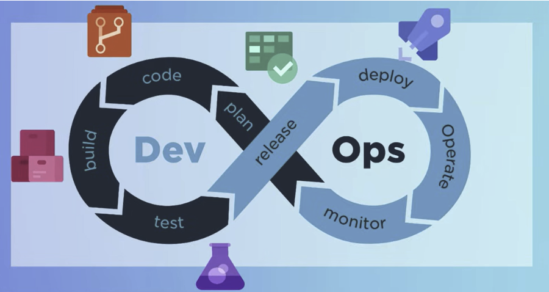

# Library Management System – projektdokumentation

## Projektöversikt

I detta projekt ska jag skapa ett enkelt digitalt bibliotekssystem och som ska utföras av Continuous Integration och Continuous Delivery (CI/CD). Applikationen ska byggas vidare på kursens demonstrationsrepository och därmed ska man använda Python, FastAPI, pytest, Ruff, Docker och GitHub Actions för att utföra projektet.

Arbetsflödet som projektet demonstrerar är:



Målet är att få en applikationen att fungera, och även kunna förklara vad varje kontroll gör, vilken risk den minskar och vad som händer om ett steg misslyckas.

## Syfte och funktioner

Biblioteket erbjuder ett REST-API för att:

- registrera böcker med titel, författare och valfritt ISBN
- visa och söka i bokkatalogen efter titel eller författare
- visa endast tillgängliga böcker
- registrera och visa användare
- låna en tillgänglig bok till en registrerad användare
- registrera återlämning och göra boken tillgänglig igen
- kontrollera hälsa och applikationsversion via `/health` och `/version`

### Regler som applikationen kontrollerar

- En bok som inte finns kan inte lånas.
- En användare som inte finns kan inte låna en bok.
- En bok som redan är utlånad kan inte lånas igen.
- En återlämnad bok blir tillgänglig på nytt.
- Samma lån kan inte återlämnas två gånger.
- Bok- och författarsökning är skiftlägesokänslig.

API:t returnerar bland annat `404 Not Found` för saknade poster och `409 Conflict` vid en ogiltig utlånings- eller återlämningskonflikt.

### API-översikt

| Metod | Endpoint | Funktion |
| --- | --- | --- |
| `GET` | `/health` | Hälsokontroll |
| `GET` | `/version` | Visar applikationsversion och miljö |
| `POST` | `/api/books` | Registrerar en bok |
| `GET` | `/api/books` | Visar katalogen; `?q=...` söker |
| `GET` | `/api/books/available` | Visar tillgängliga böcker |
| `POST` | `/api/users` | Registrerar en användare |
| `GET` | `/api/users` | Visar användare |
| `POST` | `/api/loans` | Lånar en bok med `book_id` och `user_id` |
| `POST` | `/api/loans/{loan_id}/return` | Registrerar återlämning |

Swagger-dokumentationen finns på `/docs` när applikationen körs lokalt.

## Teknisk struktur

| Sökväg | Innehåll |
| --- | --- |
| `app/main.py` | FastAPI-applikation och HTTP-endpoints |
| `app/library.py` | Biblioteksmodeller, utlåningsregler och service |
| `app/service.py` | Enkla exempel-endpoints från kursens demo |
| `tests/test_api.py` | Tester av API-endpoints |
| `tests/test_service.py` | Tester av service- och biblioteksregler |
| `.github/workflows/ci.yml` | Kontinuerlig integration: test, lint, artifact och Docker-verifiering |
| `.github/workflows/cd-simulated.yml` | Simulerad, tillfällig deployment på GitHub-runner |
| `scripts/verify.sh` | Smoke tests för hälsa och bokkatalog |
| `scripts/deploy_local.sh` | Lokal Docker-build och deployment |
| `scripts/rollback_local.sh` | Lokal återställning till en sparad image |
| `k8s/` | Valfria Kubernetes-manifest för lokal orientering |
| `docs/` | Dag 2-guide och kompletterande kursmaterial; Dag 3–6 sammanfattas i README |

## Hur projektet byggdes

Projektet utgår från kursens befintliga FastAPI-demo. Där de enkla räkne-endpointsen behölls för demoexempel, medan biblioteksfunktionerna lades till separat. Arbetet är uppdelat så att affärsregler, HTTP-gränssnitt, tester och leveransflöde går att förstå och som kontrollera var för sig.

### 1. Bibliotekets modeller och affärsregler

I `app/library.py` representeras en bok, användare och ett lån med dataklasserna `Book`, `User` och `Loan`. En bok har bland annat ett ID, titel, författare, valfritt ISBN och tillgänglighetsstatus. Ett lån kopplar ihop ett bok-ID och användar-ID och har en status för om det återlämnats.

`LibraryService` sköter reglerna och lagrar posterna i tre dictionaries i minnet. ID-räknarna börjar på 1 och ökas när nya poster skapas. En trådlåsning (`Lock`) används runt läsningar och ändringar av dessa strukturer.

- Sökningen tar bort omgivande blanksteg och jämför titel och författare utan skillnad mellan stora och små bokstäver.
- Utlåning kontrollerar i ordning att boken finns, användaren finns och boken är tillgänglig. Först därefter skapas ett lån och boken markeras som utlånad.
- Återlämning kontrollerar att lånet finns och inte redan är återlämnat. Därefter markeras lånet som återlämnat och boken som tillgänglig.

Denna lagringslösning är medvetet enkel. Inget skrivs till en databas eller fil, så innehållet försvinner när applikationsprocessen startas om.

### 2. FastAPI-gränssnitt och validering

`app/main.py` visar biblioteksfunktionerna som HTTP-endpoints. Pydantic-modellerna `BookCreate`, `UserCreate` och `BorrowRequest` beskriver indata. Titel, författare, namn och e-post måste ha minst ett tecken; bok- och användar-ID:n i ett låneanrop måste vara större än noll.

Routes anropar `LibraryService` i stället för att innehålla hela affärslogiken själva. Nya böcker, användare och lån returnerar statuskod `201`. En gemensam exception handler översätter bibliotekets fel till JSON-svar:

- saknad bok, användare eller lån ger `404`
- bok som redan är utlånad eller lån som redan återlämnats ger `409`

FastAPI skapar dessutom Swagger-gränssnittet på `/docs`, där API:t kan provas manuellt.

### 3. Dataflödet hos applikationen

Ett typiskt anrop går genom följande steg:

```text
HTTP-anrop
  → FastAPI/Pydantic validerar indata
  → endpoint i app/main.py
  → LibraryService i app/library.py tillämpar biblioteksreglerna
  → resultat eller LibraryError blir ett JSON-svar med HTTP-statuskod
```

Vilket gör att samma utlånings- och återlämningsregler kan testas direkt i tjänsten och som görs genom API:t. Hälsokontrollen `/health` visar att applikationen svarar. `/version` returnerar applikationsversionen `1.1` och miljön `demo`, så en körande container kan verifieras både för tillgänglighet och version.

### 4. Tester och isolering

`tests/test_service.py` testar reglerna direkt mot `LibraryService`, exempel sökning, saknade poster, dubbel utlåning och återlämning. `tests/test_api.py` använder FastAPI `TestClient` för att anropa API-routes hos testmiljön och kontrollera att statuskoder och JSON-svar.

API-testernas automatiska ersätter bibliotekstjänsten med en ny instans före varje gång man gör test. På samma sätt påverkar inte böcker och lån från ett test resultatet i nästa. Tester täcker även health/version, katalogsökning och de bevarade räkne-endpointsen.

### 5. CI, container och simulerad leverans

CI i `.github/workflows/ci.yml` installerar Python 3.12 och projektets beroenden på GitHub-hosted Ubuntu-runner. Pytest skriver en JUnit-rapport; rapporten laddas upp som `pytest-results`, även när den tidigare steget misslyckas (om filen finns). Därefer körs Ruff. Docker har `needs: test` och startar därför inte förräns testet har lyckats.

Dockerfile bygger på `python:3.12-slim`, installerar beroenden och startar Uvicorn på port 8000. CI bygger på en SHA-taggad image, som startar den, som därmed verifierar hälsa och bokkatalog samt kontrollerar att `/version` svarar med `1.1`. Hos verifieringsfel samlas containerloggar in, därefter tas det bort containern i ett avslutande steg.

`cd-simulated.yml` demonstrerar separat och tillfällig deployment på en GitHub-runner. Den bygger och verifierar vidare en container men publicerar inte imagen förräns ett registry och lämnar inte applikationen körande efter arbetet. Eftersom CI och CD har separata triggers väntar CD inte automatiskt på en grön CI-körning.

### 6. Lokal drift och rollback

För lokal drift bygger `scripts/deploy_local.sh` imagen `library-management:local` och startar containern `library-management-demo`. Om en container med detta övningsnamn redan finns, sparar skriptet dess image under taggen `library-management:previous` innan containern ersätts.

`scripts/verify.sh` väntar på att health-endpointen som svara och kontrollerar sedan att bokkatalogen returnerar en JSON-lista. `scripts/rollback_local.sh` kontrollerar att rollback-imagen finns, startar den och verifierar hälsa/katalog samt en valfri förväntad appversion.

Rollback fungerar bara om det finns en tidigare fungerande image att utgå från. En image-rollback återställer inte konstant data, nuvarande applikation lagrar data i minnet. Kubernetes-manifesten är en separat, valfri orienteringsövning och är inte en produktionsdeployment.

## **Projektets arbetsplan**

### 1. Planera projektet – syfte, funktioner och krav

**Genomförd**: Projektidén avgränsades för ett litet bibliotekssystem med böcker, användare, utlåning och återlämning. Kraven omfattar även sökning, tillgänglighetsstatus och automatiska kontroller av felaktiga lån.

**Tekniskt val**: Första versionen har ett litet REST-API. Inloggning, betalningar, förseningsavgifter och produktionsdatabas ingår inte i omfattningen.

**Begränsning**: Data lagras i minnet och återställs när processen startas om. Det är en medveten förenkling för CI/CD-övningen, inte en lösning för ett verkligt bibliotek.

### 2. Förbereda utvecklingsmiljön

**Genomförd:** Detta Projekt kommer att använda Python och en virtuell miljö (`.venv`). Definierade Beroenden är i `requirements.txt`. Git används för att följa kodändringar och att GitHub lagrar repositoryt och köra Actions.

Skapa och aktivera en virtuell miljö i Windows PowerShell genom att skriva in ett kommando i taget:

```powershell
python -m venv .venv
.\.venv\Scripts\Activate.ps1
pip install -r requirements.txt
```

Kontrollera därefter att man får rätt branch och ändringar används. Kär dessa kommandon en i taget:

```powershell
git status
git branch --show-current
git remote -v
```

**Teknik:** FastAPI och Uvicorn kör API:t, pytest kör automatiska tester och Ruff kontrollerar kodstil.

### 3. Bygga bibliotekssystemet

**Genomförd:** API:t kan skapa och lista böcker och användare, söka i katalogen, visa tillgängliga böcker, låna och återlämna böcker. Biblioteksregler och datahantering finns i `app/library.py`; HTTP-gränssnittet finns i `app/main.py`.

**Felhantering:** Applikationen returnerar tydliga HTTP-felkoder för poster som saknas och för böcker eller lån i ett ogiltigt tillstånd.

**Versionskontroll:** `GET /version` returnerar nu version `1.1` och miljö `demo`. CI och simulerad CD kontrollerar också svaret från en körande container.

### 4. Skriva automatiska tester – kontrollera att funktionerna fungerar

**Genomförd:** Pytest-tester täcker bland annat:

- hälsokontroll och versionsendpoint
- sökning efter bok
- nekad utlåning av bok som saknas eller redan är utlånad
- nekad utlåning till användare som saknas
- återlämning och uppdaterad tillgänglighet
- nekad upprepad återlämning
- grundläggande servicefunktioner, inklusive division med noll

Kör kontrollerna lokalt:

```powershell
python -m pytest -v
python -m ruff check app tests
```

Vid den senaste lokala kontrollen passerade **12 tester** och Ruff-kontrollen. Pytest visade även ett deprecation-varningsmeddelande från en beroendekedja (Starlette/AnyIO); varningen hindrade inte testen från att passera.

bild

### 5. Versionshantera med Git och GitHub

**Genomförd:** Projektet versionshanteras med Git. Feature branches används för arbete med en ändring i taget. Ändringar kan pushas till GitHub och föreslås för `main` genom en Pull Request (PR).

Arbetsflöde med att köra ett kommandon i taget:

```powershell
git switch -c feature/min-andring
git add app tests docs
git commit -m "Beskriv ändringen kort"
git push -u origin feature/min-andring
```

Därefter öppna en PR med `main` som **base** och feature-branchen som **compare**. Granska ändringarna och resultatet från CI innan eventuell merge. PR:et är ett förslag som för in ändring, vilket gör att den inte mergar automatiskt av sig själv.

**Viktigt:** Det är viktigt att alltid kontrollera `origin` som pekar på mitt egna GitHub-repository innan jag pushar in.

### 6. Skapa CI-pipeline – automatisera bygg- och testkontroller

**Genomförd:** `.github/workflows/ci.yml` körs vid push till `main` och `feature/**`, samt vid pull request mot `main`. Den använder en GitHub-hosted Ubuntu-runner och utför följande:

1. checkar koden och installerar Python 3.12
2. installerar beroenden från `requirements.txt`
3. kör pytest och skriver en JUnit-rapport till `reports/pytest.xml`
4. laddar upp rapporten som artifact med namnet `pytest-results`
5. kör Ruff
6. efter ett godkänt test-/lint-jobb bygger och startar en Docker-container
7. verifierar `/health`, bokkatalogen och `/version`
8. visar containerloggar vid fel och städar containern efteråt

**Varför:** Automatiska kontroller ger snabb feedback och kan fånga fel innan ändringar integreras. Docker-jobbet väntar på att testjobbet lyckas (`needs: test`).

**Begränsning:** En grön körning bevisar bara att de automatiserade kontroller som ingår har passerat. Den är inte i sig en fullständig säkerhetsgranskning eller garanti för produktionsmiljö.

### 7. Paketering och leverans – förbereda applikationen för leverans

**Genomförd:** Projektet innehåller en `Dockerfile` och `docker-compose.yml`. Docker-image kan byggas med en commitbaserad tagg i CI eller med taggen `library-management:local` lokalt.

Exempel:

```bash
docker build -t library-management:local .
```

**Leverans i den här kurslösningen:** CI bygger en image och CD-workflowen bygger en image på sin runner. Imagen publiceras inte till ett externt container registry som GHCR eller Docker Hub.

**Tekniskt val:** En tagg med commit-SHA gör det lättare att koppla en byggd image till källkodens commit. I en produktionskedja bör samma spårbara image publiceras och återanvändas mellan miljöer.

### 8. Deployment och verifiering – starta och kontrollera applikationen

**Genomfört:** `scripts/deploy_local.sh` bygger och startar containern `library-management-demo`. `scripts/verify.sh` kontrollerar att `/health` svarar och att `/api/books` returnerar en JSON-lista.

I Git Bash från projektroten:

```bash
bash scripts/deploy_local.sh
bash scripts/verify.sh
```

GitHub-workflowen `cd-simulated.yml` kör också en separat deployment på en tillfällig GitHub-runner. Den verifierar applikationen och städar containern när jobbet avslutas.

**Avgränsning:** Simulerad deployment; applikationen körs inte permanent och blir inte publicerad för externa användare. CD och CI har separata triggers, så CD är inte automatiskt en release-gate som väntar på grön CI.

Kubernetes-manifest finns i `k8s/` som en valfri lokal övning. De har inte verifierats mot ett lokalt kluster i denna utvecklingsmiljö. Kontrollera alltid aktiv `kubectl`-context och använd endast ett lokalt övningskluster.

### 9. Felhantering och rollback

**Genomförd:** Workflowen kan visa containerloggar om verifieringen misslyckas och städar containern även vid fel. Dag 6-avsnittet i README beskriver felsökning från första röda steget: kontrollera commit och trigger, läs loggen, formulera en hypotes, återskapa felet och verifiera rättningen.

`scripts/deploy_local.sh` sparar den befintliga containerns image som `library-management:previous` innan den ersätter containern. `scripts/rollback_local.sh` kan starta den sparade imagen och verifiera hälsa, katalog samt valfri förväntad appversion:

```bash
bash scripts/rollback_local.sh library-management:previous 1.1
```

**Viktig begränsning:** Första deploymenten har ingen tidigare image att återställa. Rollback av en image återställer inte beständig data. I nuläget lagras dessutom applikationsdata endast i minnet. En rollback fungerar bara som verklig kodåterställning om den sparade imagen kommer från en tidigare fungerande version.

### 10. Dokumentation och demonstration

Denna fil sammanfattar projektets mål, genomförda funktioner och CI/CD-kedja. Övriga guider finns i `docs/`:

- Slutprojektets steg-för-steg-guide finns under [README.md](README.md)
- [Dag 2 – CI](docs/day-02-ci.md)
- Dag 1–6 sammanfattas i [README.md](README.md)

Demonstration kan visar:

1. hur en bok och användare registreras och hur en bok lånas och återlämnas
2. ett automatiskt test som kontrollerar en biblioteksregel
3. en GitHub Actions-körning och JUnit-artifacten
4. Docker-build och resultatet från API-verifieringen
5. en felsöknings- eller rollback-övning
6. vilka begränsningar som finns och hur systemet skulle kunna utvecklas vidare

Förklara vid varje del: **Vilket problem löser detta? Vilken risk minskar det? Vad händer om kontrollen misslyckas?**

## Starta applikationen lokalt

Aktivera den virtuella miljön och starta FastAPI:

```powershell
.\.venv\Scripts\Activate.ps1
python -m uvicorn app.main:app --reload
```

Öppna sedan `http://127.0.0.1:8000/docs` för att prova API:t. Starta en ny terminal för tester och kör `python -m pytest -v`.

## Nästa möjliga utvecklingssteg

Projektets medvetna begränsningar ger förslag på fortsättning:

- byt minneslagringen mot SQLite så data överlever omstart
- lägg till fler validerings- och API-tester
- aktivera GitHub branch protection så merge kräver godkända kontroller
- lägg till testtäckningsrapport eller beroendesårbarhetskontroll
- omfatta faktisk artifact-/image-publicering och en skyddad testmiljö först när det ingår i uppgiften

Utöka projektet stegvis och uppdatera tester, workflow och dokumentation tillsammans med varje beteendeförändring.
